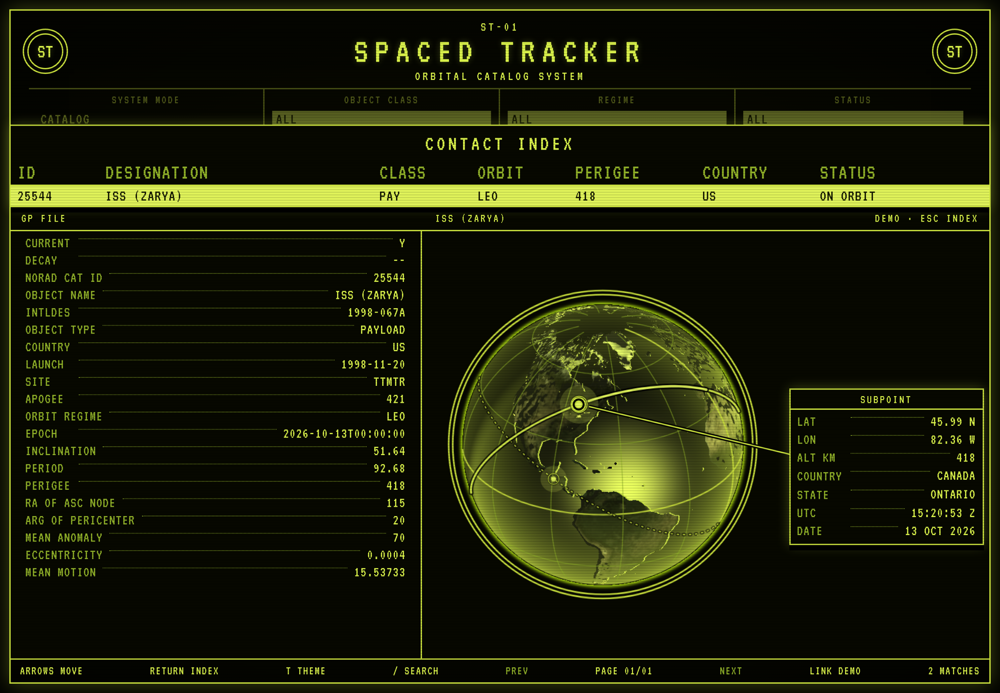

# kschroeder/spaced-tracker-ui

CRT catalog console for the Spaced Tracker API. The screen is a Vue 3 application. PHP serves it and the API on one origin, so the browser never sees a Space-Track password, a session cookie, or a model API key.

The layout follows a phosphor terminal: black-olive field, yellow-green rules, circular marks, stacked status panels, an inverted selected row, and a footer of key hints. The title is SPACED TRACKER / ORBITAL CATALOG SYSTEM. Color themes are phosphor (the default), green, amber, and white. Scanlines, vignette, and a light glow supply the CRT look. `prefers-reduced-motion` turns the remaining motion off.



The [console guide](docs/console.md) walks through the index, the object file, and the ground tracks.

## Install

Install [kschroeder/spaced-tracker-ui](https://packagist.org/packages/kschroeder/spaced-tracker-ui) from Packagist. Composer installs `kschroeder/spaced-tracker-api` and `kschroeder/spaced-tracker` from Packagist as well:

```bash
composer require kschroeder/spaced-tracker-ui:^1.0
```

To work on this repository, which has no lock file:

```bash
composer update
cd frontend
npm install
npm run build
```

`npm run build` writes the console to `public/app/`. That directory is generated. Commit the Vue source, not the build.

The PHP package depends on `kschroeder/spaced-tracker-api`, which depends on `kschroeder/spaced-tracker`, and on `vlucas/phpdotenv` and `symfony/http-client`. The HTTP client is what live mode uses to call Space-Track. This checkout's `composer.json` fetches the two Spaced Tracker packages from GitHub. Replace those repository entries with path repositories of `../spaced-tracker` and `../spaced-tracker-api` when Composer should symlink neighboring checkouts instead.

## Run it

Copy the example environment and edit it:

```bash
cp .env.example .env
```

Leave `SPACETRACK_IDENTITY` empty to stay in demo mode. Set the identity and password for live Space-Track queries. The repository ignores `.env`. Do not commit it. `bin/spaced-tracker-ui` and `public/index.php` load that file. A variable already set in the process environment wins, including an empty value. The loader does not call `putenv()`. If `.env` is missing, an empty `SPACETRACK_IDENTITY` still selects demo mode. Restart the PHP server after adding or changing the file.

PHP built-in server, bound to loopback:

```bash
vendor/bin/spaced-tracker-ui
```

The default address is `http://127.0.0.1:8088`. `SPACED_TRACKER_HOST` and `SPACED_TRACKER_PORT` override it. The host must be a hostname or an IP address. The port must be an integer from 1 to 65535. The command sets the PHP built-in server document root to `public/`, which is required for `/app` assets.

A normal web server should use `public/` as the document root and route every request that is not a real file through `public/index.php`. `public/router.php` is the router for the PHP built-in server. It serves a file only when `FrontController::resolveInside()` can prove the file stays inside `public/`.

Live mode configures the Space-Track client with a file cache. A successful query is reused for the cache default of 60 seconds. The session cookie is stored in that same cache until the session expires. Session lifetime stays on `SPACETRACK_SESSION_TTL`, whose default is 7200 seconds. The directory defaults to the system temp directory under `kschroeder-spaced-tracker-ui`. `SPACED_TRACKER_CACHE_DIR` and `SPACED_TRACKER_CACHE_TTL` override the directory and the 60 second default. Keep the cache directory outside `public/`. Demo mode does not use the cache.

`SpacedTracker\Ui\FrontController` is the entry class. It mounts the API at `/api` and serves `public/app/index.html` for every other route, so `/catalog` still loads the console.

```php
use SpacedTracker\Ui\Environment;
use SpacedTracker\Ui\FrontController;

FrontController::fromEnvironment(Environment::load())->run();
```

Until the Vue app has been built, those routes answer `503` with the `npm run build` instruction.

### Vite during development

Leave the PHP server on port 8088 and start Vite from `frontend/`:

```bash
npm run dev
```

Vite listens on `http://127.0.0.1:5173` and proxies `/api` to `http://127.0.0.1:8088`. The production build uses the base path `/app/` so PHP can serve the assets. The dev server uses `/`.

## What the console calls

| Control | Request |
| --- | --- |
| SYSTEM MODE CATALOG | `POST /api/query` class `satcat` |
| ELEMENTS | class `gp` |
| DECAY | class `decay` |
| REENTRY | class `tip` |
| OBJECT CLASS PAY, R/B, DEB | `OBJECT_TYPE` of `PAYLOAD`, `ROCKET BODY`, or `DEBRIS` |
| REGIME other than ALL | JSON field `orbit` (`LEO`, `MEO`, `GEO`, `HEO`) |
| SEARCH | `OBJECT_NAME` `~~` predicate |
| STATUS ON ORBIT | satcat `DECAY` `null-val` and `CURRENT` `Y` |
| STATUS DECAYED | satcat `DECAY` `<>null-val` |
| STATUS HISTORICAL | satcat `CURRENT` `N` and `DECAY` `null-val` |
| CATALOG order | `order_by` `LAUNCH` `desc`. Fixed for CATALOG. ELEMENTS, DECAY, and REENTRY omit it |
| SITE | buttons show `LAUNCH_SITE` from class `launch_site`. CATALOG sends `SITE` set to `SITE_CODE`. ALL omits it |
| PREV / NEXT | pages of 50. Page 1 omits `offset`. Later pages send it. `metadata` is true, and the footer reads `Total` |

The console leaves `format` off the request, and the API defaults that to json. STATUS predicates and the launch sort are sent only for CATALOG. ELEMENTS, DECAY, and REENTRY do not share `DECAY`, `CURRENT`, `LAUNCH`, or `SITE`. Those modes still filter returned rows by status, and a selected site drops rows whose record has a different `SITE`. The site list scrolls inside its panel. The contact index keeps the column head fixed and scrolls the body.

Each index page asks for 50 rows. The footer shows the page and `metadata.Total`. REGIME still filters a page after the query returns, so a regime can shorten the rows on that page. The page count follows the query total.

Opening a file draws one full ground track for every row on that page. A catalog row supplies the shape from inclination and period. An elements row also draws a dot at the subpoint from its epoch, node, and anomaly. The plate follows the open file.

The table columns are ID, designation, class, orbit, perigee, country, and status. Perigee renders as `--` when the catalog row has no value. Arrow keys move the selection when focus is not in the search box. Return opens the object file. Escape closes it. `T` or the footer button cycles the CRT color. The choice is stored in `localStorage` under `spaced-tracker-theme`. `/` focuses search.

`GET /api/health` prints one footer value, `LINK LIVE` or `LINK DEMO`. A failed request sets `LINK OFFLINE`.

With an empty `SPACETRACK_IDENTITY`, or with `SPACED_TRACKER_DEMO` set, the API is in demo mode and the table fills from the built-in catalog. No Space-Track account is required.

## Embed

`FrontController::fromEnvironment()` builds the API client, including the live-mode file cache, and mounts it at `/api`. Pass an application yourself when the process already has one. The constructor adds the `/api` prefix when the application does not have it yet. That application keeps whatever client it was given. `Environment::load()` reads this package's `.env` and passes the merged variables in. It does not read the file when you pass your own array to `fromEnvironment()`.

```php
use SpacedTracker\Ui\Environment;

$env = Environment::load();
$front = new FrontController(
    Application::fromEnvironment($env),
    __DIR__ . '/public',
);
$response = $front->handle($request);
```

Credentials belong in the package `.env` or the PHP environment. Do not add a login form. `POST /api/session` uses the server account and does not return a `Set-Cookie` header.

## Tests

```bash
composer test
cd frontend && npm test
```

PHPUnit covers the same-origin split between `/api` and the console, the refusal to read files outside `public/`, the missing-build response, the live-mode file cache, and loading `.env` without overriding the process environment. Vitest covers the query builder, launch sites, the CRT themes, reduced motion, selecting a row, ground tracks, and the place under a subpoint.
