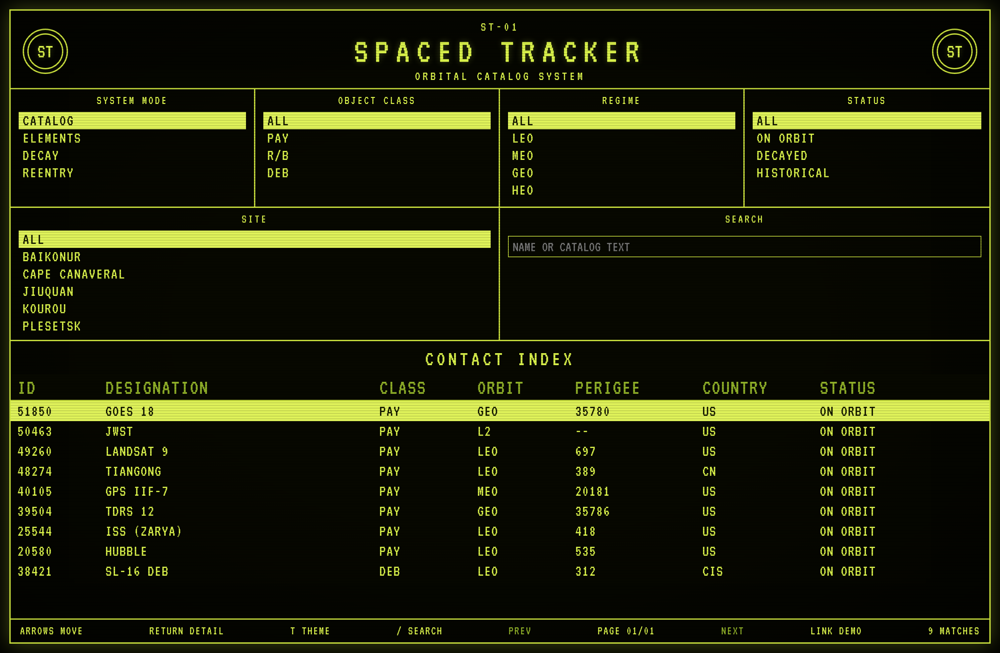
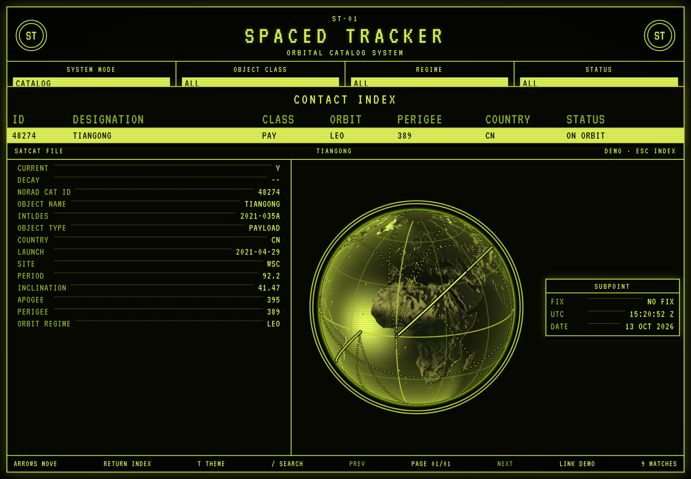

# The console

The console is the catalog screen. PHP serves it with the API, and the browser never sees a Space-Track password. Install and run instructions are in the [README](../README.md).

The pictures below are the built console with a fixed page of public objects, and the footer reads `LINK DEMO`. The subpoint in the ISS picture is the console's own propagation of the elements printed in that file. It is a sample set chosen so the dot falls on land.

## Index

The deck across the top is the query:

| Panel | What it sends |
| --- | --- |
| SYSTEM MODE | `CATALOG` is `satcat`, `ELEMENTS` is `gp`, `DECAY` is `decay`, `REENTRY` is `tip` |
| OBJECT CLASS | `PAY`, `R/B`, or `DEB` becomes `OBJECT_TYPE` |
| REGIME | `LEO`, `MEO`, `GEO`, or `HEO` in the `orbit` field. `ALL` omits it |
| STATUS | `ON ORBIT`, `DECAYED`, or `HISTORICAL`, sent only for `CATALOG` |
| SITE | The button shows the full launch-site name. The list scrolls. `CATALOG` sends the site code. `ALL` omits it |
| SEARCH | `OBJECT_NAME` contains the text |

`CATALOG` asks for the newest launches first. The other modes omit that order. `STATUS` and `SITE` are catalog predicates. On the other modes the console still drops returned rows whose status or site does not match.

Each page asks for 50 rows. The footer shows the page and `metadata.Total`. `PREV` and `NEXT` move through those pages. `REGIME` is applied to the rows that come back, so one page can be shorter than 50 while the page count still follows the query total. The picture is one page of a demo catalog, so the footer reads `PAGE 01/01`. The match count is the number of rows on that page. The demo catalog in `kschroeder/spaced-tracker-api` is the current set.

The contact index keeps the column head fixed and scrolls the body. Columns are ID, designation, class, orbit, perigee, country, and status. A missing perigee is `--`. The selected row is inverted.

Keys, when the search box is not focused:

| Key | Action |
| --- | --- |
| Up / Down | Move the selection |
| Return | Open the file, or return to the index |
| Escape | Return to the index |
| `/` | Focus search. An open file closes first |
| `T` | Cycle the color: phosphor, green, amber, white |

`T` is also the first footer button. The choice is stored in `localStorage` under `spaced-tracker-theme`. Phosphor is the default.

`GET /api/health` supplies the footer link: `LINK LIVE`, `LINK DEMO`, or `LINK OFFLINE` when the request fails.

## Object file

Return, or a click, slides the index down to the selected row and opens the file. The left column lists the fields on the record that came back. Escape, or Return, closes it.

A catalog row with inclination and period draws the shape of one revolution. That shape uses the ascending node at longitude zero. With no epoch, the plate reads `NO FIX`. JWST in the index has neither period nor inclination, so it adds no track.

`ELEMENTS` opens a `GP FILE`. An epoch, with inclination and period, places a dot at the subpoint. The plate then shows latitude, longitude, altitude, and the country and state under that point. Ocean is a dash in both place fields. The open file keeps the leader from its dot to the plate.

## Ground tracks

Opening a file draws one revolution for every row on that page.

The open file is a solid track, with a short brighter nose in the direction of motion. The other rows are thinner and dotted. A row that has a subpoint also gets a ring. The open file's ring is larger. The others are smaller, and they have no leader.

The painter strokes the part of each track on the facing side of the globe. Drag the earth to bring the rest around.

When the record includes right ascension of the ascending node, argument of perigee, and mean anomaly, the dot follows those angles. Propagation is a Kepler orbit plus Greenwich sidereal time. A record with an epoch and no angles still gets a dot: at the epoch it sits on the equator at longitude zero, and it steps from there. A record with no epoch keeps the shape and stays `NO FIX`.
